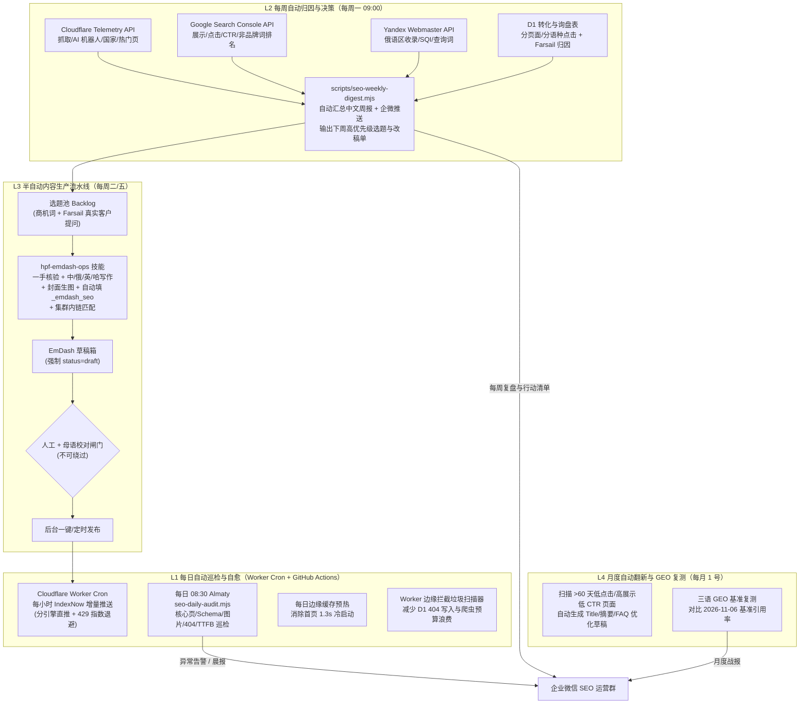

# HPF.kz SEO 策略更新与自动运营方案（v2.0）

> 制定日期：2026-11-27（Asia/Almaty）  
> 数据基线周期：2026-10-25 至 2026-11-26（生产 D1 数据库 + Cloudflare Workers 实测遥测 + 线上抓取验证）  
> 适用范围：`https://hpf.kz`（EN / ZH / RU / KK 四语官网、EmDash CMS、Cloudflare Workers、Farsail 询盘工作台）

---

## 一、历史运营数据复盘（实测事实诊断）

基于生产数据库 `hpf-website-cms`（D1）、Cloudflare Workers 遥测（`astro-hpf-kz` 近 7 天）、2026-11-06 搜索与 AI 引用基准及 2026-11-26 首份巡检晨报，当前官网运营呈现**“内容产量不低、AI 抓取已起势，但传统搜索盲区大、技术阻塞多、转化归因断层”**的特征。

### 1.1 流量、爬虫与地区结构（Cloudflare Workers 近 7 天遥测，10×抽样估算）

| 指标维度 | 实测数据（近 7 天） | 核心诊断 |
|---|---:|---|
| 全站请求状态分布 | HTTP 200：`35,120`；**404：`6,650`**；301：`420`；410：`10` | 404 占比偏高；10/25–11/26 累计 D1 `_emdash_404_log` 记录 **8,592 次 / 1,251 条路径**，大量为 `.git`/`.env`/`wp-json` 扫描器，白耗 Worker 与 D1 额度 |
| 公开 GET 200 访问结构（共 ~5,740） | 未验证/浏览器/内部工具：`3,580`（含 `codex-mcp-client` ~530、`HeadlessChrome` ~340、`curl/node` ~210）；**Page Preview：`950`（16.6%）**；**AI 爬虫+AI 搜索+AI 助手：`690`（12.0%）**；SEO 工具：`270`（4.7%）；**传统搜索引擎爬虫：`240`（4.2%）** | **AI 抓取量已达传统搜索引擎的近 3 倍**（PetalBot 290、ClaudeBot 110、GoogleOther 90、Amazonbot 60、ShapBot 50、meta-externalagent 40、Applebot 20、ChatGPT-User 20、GPTBot 10）；社交/WhatsApp 卡片预览（`meta-webindexer`）活跃 |
| 传统搜索引擎抓取 | Bingbot：`120`；Googlebot：`100`（移动 90 + 桌面 10）；ExaSearchBot：`10`；**YandexBot：`0`**；**真实 Baiduspider：`0`**（日志中 20 次 Baiduspider 为伪造 UA 扫描 `/.env.development.local` 与 `/config/production.json`，全部 404） | **严重盲区**：哈萨克斯坦与俄语 B2B 核心引擎 **Yandex 完全未抓取**，百度真实抓取也为 0 |
| 外部自然搜索 Referer | `www.google.com`：`30`（落地页仅 `/`、`/ru/`、`/services/`、`/news`）；`www.bing.com`：`10`；**Yandex / Baidu：`0`** | 145 篇新闻详情页几乎尚未产生直接自然搜索点击，流量仍集中在首页与栏目页 |
| 访客地理分布（GET 200） | US：`2,250`（爬虫为主）；**KZ：`1,480`**；SG：`570`；NL：`440`；CA：`260`；DE：`130`；**CN：`90`**；GB：`70`；HK：`50`；PL：`40`；TR：`10`；**RU 未进前 25** | 哈萨克斯坦本地活跃，但**中国出口货主（CN）与俄语区周边（RU/CIS）流量严重不足** |

### 1.2 商业转化漏斗（D1 `hpf_contact_clicks` & `hpf_farsail_inquiries`，11/05–11/26 共 22 天）

| 转化节点 | 实测数据 | 问题剖析 |
|---|---|---|
| 联系点击事件（22 天累计） | 总计仅 **7 次**：`enquiry` 4 次（含 11/26 测试单）、`email` 1 次、`whatsapp` 1 次、`phone` 1 次 | 转化绝对量极低；11/08–11/25 因发布分支漏合，官网表单退回 `mailto:` 导致 18 天在线询盘断层（11/26 已修复入 Farsail #8） |
| 归因粒度 | `hpf_contact_clicks` 仅记录 `(day, event, count)`；`?from=news:<slug>` 刚于 11/26 上线 | **无法判断哪篇文章、哪个语种带来 WhatsApp/电话/邮件点击**，内容 ROI 处于盲飞状态 |

### 1.3 内容资产审计（D1 `ec_news` / `_emdash_seo` / `ec_products`，10/25–11/26）

| 维度 | EN | ZH | RU | KK | 核心问题 |
|---|---:|---:|---:|---:|---|
| 已发布新闻数（草稿数） | 36 (2) | 36 (2) | 36 (2) | 37 (1) | 总计 145 篇，但发文呈脉冲式（11/04–11/11 连发 21 篇，11/18–11/25 断更 8 天） |
| 母语校对完成（`native_reviewed=1`） | **0** | 1 | **0** | **0** | **109 篇外语公开内容全部为 AI 初稿**，影响俄语/哈语 B2B 客户专业信任度 |
| 平均标题长度（字符） | **74.3** | 24.6 | **76.8** | **77.8** | EN/RU/KK 普遍超出 Google 60 字符截断线，关键业务词在搜索结果中被截断 |
| 平均摘要长度（字符） | 104.4 | **38.2** | 96.4 | 93.8 | ZH Meta Description 过短（理想 65–85 字），削弱 SERP 摘要吸引力 |
| `_emdash_seo` 覆盖数 | 29 / 36 | 30 / 36 | 30 / 36 | 31 / 37 | 约 18% 缺失自定义 SEO 元数据；**更严重的是前端模板根本未读取该表（见 1.4 漏洞 3）** |
| 已发布运输产品（`ec_products`） | **0** | **0** | **0** | — | 核心商业转化落地页处于空页 `noindex` 状态 |

此外，36 个已发选题的结构存在**商业意图偏差**：
- **6 篇泛化“物流 AI / 仓库机器人”概念文**（如 `logistics-ai-error-containment`、`warehouse-scheduling-beyond-robots`、`ai-logistics-human-oversight` 等）：不含中哈欧跨境物流商业关键词，难以带来货主询盘。
- **单点项目新闻评论偏多**（奶酪厂、红砖厂、刨花板厂等），标题偏向媒体反问句，**缺少直接命中采购/物流总监搜索习惯的高意向商业长尾词**（如“中国到阿拉木图卡车运费构成”“霍尔果斯 TIR 通关清单”“Доставка грузов из Китая в Казахстан авто TIR”）。
- **翻译组与路由断层**：`middle-corridor-shipping-checklist` 仅发布了哈语单语；哈语主站 `/kk/` 返回 `404`，37 篇哈语新闻缺乏承接转化的母语落地页。

### 1.4 实测暴露的 5 个高危技术 SEO 漏洞（必须优先止血）

| 优先级 | 漏洞描述 | 实测证据与影响 |
|---|---|---|
| **P0** | **`robots.txt` 封杀全站新闻封面图与 `og:image`** | 线上 `robots.txt` 含 `Disallow: /_emdash/`，而所有 145 篇新闻的封面图与 `og:image` 均托管于 `/_emdash/api/media/file/<id>`。**Googlebot / YandexBot / Bingbot 被禁止抓取全部文章配图**，直接损害 Article 富结果、Google Images 与 Discover 曝光。 |
| **P0** | **IndexNow 自动推送陷入 HTTP 429 死循环（0 成功）** | 生产 Worker 每 15 分钟执行 `runIndexNowSweep`，因 `hpf_seo_indexnow_sent` 为 **0 行**，每次批量推 50 条至 `api.indexnow.org` 全部返回 **`HTTP 429`**，且无退避机制，每天空打 96 次持续触发限流，**实际推送成功数为 0**。 |
| **P1** | **`NewsArticle.astro` 忽略 `_emdash_seo` 自定义标签 + 内链非语义化** | `src/components/NewsArticle.astro` 第 111 行硬编码 `title={data.title} \| HPF.kz`，**后台 126 条自定义 `seo_title`/`seo_description` 未生效**；相关阅读仅机械取最新 3 篇，未形成主题集群（Topic Cluster）内链权重传递。 |
| **P1** | **恶意扫描 404 打穿 D1 + 历史真实路径缺失 301 + 首页冷启动 TTFB 慢** | 近 7 天 6,650 次 404 写入 D1；真实人类/爬虫访问的 `/about-us`、`/contacts/`、旧 `/news/insights/...` 均 404；2026-11-26 晨报显示首页 `/` TTFB 达 **1,322ms**（边缘缓存未预热）。 |
| **P1** | **每日巡检脚本未接入定时调度与推送通道** | `scripts/seo-daily-audit.mjs` 已写就，但本机 cron/LaunchAgents 与云端 CI 均未启用定时运行，企微 Webhook 也未配置，尚未形成“无人值守运营”。 |

---

## 二、新版 SEO + GEO 战略更新（v2.0）

### 2.1 战略总转向（从 v1.0 建站发稿 → v2.0 商机获客 + AI 引用双轮驱动）

| 维度 | v1.0 现状（10/25–11/26） | v2.0 新策略（11/27 起） |
|---|---|---|
| 核心目标 | 补齐技术底座 + 脉冲式填充文章数 | **以“有效商机询盘 + AI 答案引用率 + 非品牌商业词点击”为北极星** |
| 引擎重心 | 被动等 Google 收录 | **三轨并行**：Google（国际/中英俄）+ **Yandex（哈国/俄语 B2B 补课）** + **GEO（ChatGPT / Claude / Gemini / Perplexity）** |
| 语言资源配置 | 四语机械均摊（EN/ZH/RU/KK 全发同等内容） | **按买方意图差异化主攻**：ZH 攻中国出口货主，RU 攻哈国/CIS 本地采购与 Yandex，EN 攻国际 EPC 与 AI 语料，KK 做轻落地页承接 + 重点实务 |
| 选题策略 | 泛物流 AI 概念文 + 热点新闻评论 | **聚焦 5 大高变现支柱集群（Pillar & Cluster）**，停发泛 AI 概念文，用 Farsail 真实客户询盘问题反哺选题 |
| 发文节奏 | 脉冲式（一周 20 篇、断更 8 天） | **稳态高频低噪**：固定每周 **2 篇深度实务/商业指南**（周二、周五），外加每月 2 次核心老文数据翻新 |
| 质量与合规 | AI 四语直出，`native_reviewed` 接近 0% | **高转化页与 Top 20 商业文章优先母语校对**；坚守“不虚构运力/不承诺固定时效运价”的品牌底线 |

### 2.2 四语定位与承接矩阵

1. **中文主站（`/zh/`）— 面向中国出口制造商、EPC 承包商、跨境供应链负责人**
   - **主攻词群**：中国到哈萨克斯坦卡车运输/TIR、霍尔果斯/巴克图口岸清关、哈萨克斯坦白关合规、超大件工程设备运往哈萨克斯坦、阿拉木图海外仓/冷链。
   - **渠道重点**：Google 中文 + 微信/企微传播卡片（已实测 Meta/社交预览占比高）+ 百度基础可抓取性修复 + 中文 AI 助手（豆包/元宝/DeepSeek/Kimi 均强依赖结构化中文事实页）。
2. **俄语主站（`/ru/`）— 面向哈萨克斯坦本地进口商、矿业/基建/农业采购方、CIS 货主**
   - **主攻词群**：`доставка грузов из Китая в Казахстан авто`、`TIR перевозки Китай Казахстан`、`таможенная очистка в Казахстане из Китая`、`склад и дистрибуция Алматы`、`перевозка негабаритного оборудования Китай Казахстан`。
   - **渠道重点**：**Yandex Webmaster + Yandex Business 实体认证 + IndexNow 直推 Yandex**（补齐 0 抓取的最大增长洼地）+ 2GIS 强化同步。
3. **英语主站（`/`）— 面向跨国 EPC、欧洲—中亚贸易商及全球 LLM 训练/检索语料**
   - **主攻词群**：`China Kazakhstan road freight / TIR`、`Middle Corridor logistics forwarder`、`Trans-Caspian truck ferry handoff`、`Almaty warehousing and Kazakhstan distribution`。
   - **渠道重点**：Google 国际 + Bing + **GEO（`/llms.txt`、清晰结论首段、结构化表格、FAQPage Schema）**。
4. **哈语频道（`/kk/`）— 本地化信任背书**
   - 补齐轻量化 `/kk/` 首页（或 301/明确双语承接页，消除 `/kk/` 404），确保 37 篇已发哈语文章的流量能顺畅流向 WhatsApp/电话/询盘表单。

### 2.3 五大商业支柱集群（Topic Clusters）与着陆页升级

立即**停止发布**与主营货运无直接关联的泛 AI/机器人理论文章，所有新稿与内链严格归入以下 5 大支柱集群（每篇 Cluster 文章文末精准内链到对应 Pillar 支柱页 + 同集群 3 篇相关文章 + 带具体路线/货物参数的询盘按钮）：

| 集群编号 | 支柱页（Pillar） | 对应高意向商业关键词（中 / 俄 / 英） | 优先补齐的缺口内容 |
|---|---|---|---|
| **C1** | `/services/`（TIR 公路与整车） | 中哈 TIR 货运/卡车运费构成；`TIR Китай Казахстан цена сроки`；`China Kazakhstan TIR trucking quote` | **上架 `/products/` 首批产品页**：中国—阿拉木图 FTL 整车、中哈 TIR 快线、冷链冷藏车、超大件低板车、阿拉木图仓配、清关预审服务（解除空页 `noindex`） |
| **C2** | `/routes/`（口岸与三大走廊） | 霍尔果斯/巴克图/阿拉山口预约与拥堵；`Хоргос очередь автоперевозки`；`Khorgos border crossing truck transit` | 中哈主要公路口岸对比表（霍尔果斯 vs 巴克图 vs 都拉塔 vs 阿拉山口）、跨里海阿克套/库雷克滚装船交接实务 |
| **C3** | `/services/#customs`（清关与白关合规） | 哈萨克斯坦白关清关单证/EAEU HS 编码；`белая таможня Казахстан из Китая документы`；`Kazakhstan EAEU customs documents China` | 《中哈“白关”清关单证自查清单》《木质包装 ISPM-15 与 EAEU 技术认证指南》（强可下载/可复制清单，极易被 AI 引用） |
| **C4** | `/products/` + 行业专页（项目/超大件/冷链） | 矿业/光伏/风电/食品设备运往哈萨克斯坦；`доставка оборудования из Китая в Казахстан`；`oversize equipment trucking Kazakhstan` | 将现有高表现设备/冷链文章聚合成专题导览，文内嵌入“提交设备尺寸与轴重核查”定向 CTA |
| **C5** | `/about/`（阿拉木图本地仓配与企业可信度） | 阿拉木图清关仓储本地派送；`склад ответхранения Алматы`；`Almaty warehouse distribution Kazakhstan` | 补齐真实企业信任背书（Google Business Profile、Yandex Business、2GIS 一致 NAP 信息 + 脱敏操作流程实拍，逐步替换纯 AI 概念图） |

### 2.4 GEO（生成式引擎优化）专项打法（顺应 AI 爬虫 3× 爆发趋势）

结合近 7 天 ClaudeBot/PetalBot/ChatGPT-User/GoogleOther 抓取达 690 次的现实，将每篇商业文章与核心页面按“**AI 优先可引用格式**”升级：
1. **首段“答案卡”（40–60 字结论前置）**：直接在 H1 下方给出可直接摘录的业务回答（含适用条件与边界），降低 AI 抽取成本。
2. **结构化对比表 + 核对清单**：所有政策/口岸/单证/路线类文章必须包含至少 1 张 Markdown 表格或编号清单（AI 引用率显著高于纯段落散文）。
3. **动态 `/llms.txt` + `/llms-full.txt`**：从当前静态 `public/llms.txt` 升级为 Worker/Astro 动态生成，自动纳入**最新已核验的核心服务、运输产品与 Top 20 支柱指南链接**。
4. **明确实体声明与边界**：在页面和 JSON-LD 中持续强化 `HPF KZ LLP`、`BIN 241040015643`、`Almaty` 坐标、四语服务能力，并保留清晰的合规/核验状态标注（增强 AI 信任评分）。

---

## 三、SEO 自动运营方案（5 层闭环无人值守体系）

### 3.1 自动化系统总架构

### 3.2 各层自动化运行细则与排期表

| 周期 | 执行时间（Almaty） | 自动化任务 | 执行载体 | 输出物 / 触达 |
|---|---|---|---|---|
| **实时** | 访客/爬虫触发 | 边缘拦截 `.env`/`.git`/`wp-*` 等扫描器（直接返回 404/410 不写 D1）；真实历史路径（`/about-us`、`/contacts/`）301 重定向；联系点击带 `path + lang + from` 记入 D1 | Cloudflare Worker (`src/seo/worker-seo.mjs`, `src/worker.ts`) | 干净的 D1 转化与 404 日志 |
| **每小时** | 每小时整点 | `runIndexNowSweep` 升级版：仅在 D1 有新增/更新 URL 时触发，每次最多推 10 条，**分别直推 `api.indexnow.org` / `yandex.com/indexnow`**，遇 429 自动写入 `next_retry_at` 做指数退避（1h→4h→24h） | Cloudflare Worker `scheduled` (`src/seo/indexnow.mjs`) | D1 `hpf_seo_indexnow_sent` 状态表 |
| **每日** | 08:30 | ① 预热核心 16 页边缘缓存；② 运行 `scripts/seo-daily-audit.mjs --write-report`，新增检查项：`robots.txt` 是否放行 `/_emdash/api/media/file/`、IndexNow 24h 推送成功率、`_emdash_seo` 生效校验、新增非扫描器 404 告警 | GitHub Actions（推荐，独立不依赖本机开机）+ 企微 Webhook | `ops/seo-reports/YYYY-MM-DD.md` + 企微晨报（0 异常发精简摘要，有红灯立刻 @ 负责人） |
| **每周** | 周一 09:00 | 运行 `scripts/seo-weekly-digest.mjs`：自动拉取 **Cloudflare o11y + GSC + Yandex Webmaster + D1 转化** 四方数据，输出《HPF.kz SEO/GEO 周报》与下周 Top 3 优先优化页/选题建议 | GitHub Actions / 服务器定时脚本 | `ops/seo-reports/weekly-YYYY-Www.md` + 企微周报 |
| **每周** | 周二 & 周五 | **固定双更内容流水线**：从选题池取 1 个商业高意向选题 → 运行 `hpf-emdash-ops` 自动查重、核验、生成中/俄/英/哈草稿 + 规范长度 `seo_title`/`seo_description` + 集群内链 → 提交 EmDash 草稿箱 → 人工/母语校对后定时发布 | Codex / Antigravity + `hpf-emdash-ops` + EmDash MCP | 每月稳定 **8 篇高意向商业实务深度稿** |
| **每月** | 每月 1 日 10:00 | ① **内容翻新扫描**：自动标出“高展示低 CTR（CTR < 2%）”和“发布 60 天零搜索展示”文章，生成标题/摘要/FAQ 改写提案；② **GEO 基准复测**：按中/英/俄固定商业问题集复测 Google AI Overviews / ChatGPT / Gemini / Perplexity 引用率 | 自动脚本 + 运营复核 | `ops/seo-reports/monthly-YYYY-MM.md` |

### 3.3 自动化安全与合规红线（不可突破）

1. **草稿隔离红线**：任何 AI 自动生成的内容只能进入 EmDash `draft` 状态，**禁止脚本自动 publish / schedule**，外语版本必须经本地母语同事校对后才勾选 `native_reviewed=1` 并发布。
2. **业务承诺边界**：自动化写作严格沿用 `HPF_KZ_BRAND_LANGUAGE_ZH_V2.md`，不自动虚构时效、运价、船期、车队规模或清关包过承诺。
3. **凭据隔离**：GSC Service Account、Yandex OAuth、Cloudflare API Token、企微 Webhook 均存放在 GitHub Secrets / Cloudflare Secrets，绝不入库进 Git。

---

## 四、分阶段落地执行清单（P0 → 90 天）

### 阶段一：第 1 周 — P0 技术止血与数据补齐（工程量约 1–2 天，立即可做）

| 序号 | 改造项 | 涉及文件 / 配置 | 预期效果 |
|---|---|---|---|
| **1** | **放行全站新闻图片抓取** | `src/seo/worker-seo.mjs`（拦截/改写 `/robots.txt` 响应，在 `Disallow: /_emdash/` 之前/之后显式增加 `Allow: /_emdash/api/media/file/`，并补充 `Host: https://hpf.kz` 供 Yandex 识别） | 立即解除全站 145 篇新闻封面图与 `og:image` 的抓取封锁 |
| **2** | **修复 IndexNow 429 死循环** | `src/seo/indexnow.mjs` & `src/worker.ts`（改为每小时触发、每次限 10 条、记录 `hpf_seo_indexnow_state` 冷却时间遇 429 指数退避、支持分推 Bing/Yandex） | 彻底止住每天 96 次 429 报错，让新文章分钟级送达 Bing/Yandex |
| **3** | **打通 `_emdash_seo` 元数据 + 主题集群内链** | `src/news.ts` & `src/components/NewsArticle.astro`（优先读取 `_emdash_seo.seo_title`/`seo_description`；相关阅读改为按 `category`/关键词标签相似度匹配同集群文章，而非仅取最新 3 篇） | 126 条自定义 SEO 标题/摘要立刻生效，站点内链权重聚焦 5 大商业集群 |
| **4** | **升级转化归因统计（D1）** | `src/worker.ts`、`public/hpf-contact-analytics.js`、`ops/contact-analytics-schema.sql`（新增 `hpf_contact_events_v2` 或扩展列记录 `day, event, lang, path, source_ref, count`，依然不存访客 PII） | 精确看到“哪篇文章/哪个语种”带来了 WhatsApp/电话/邮件/表单询盘 |
| **5** | **边缘拦截垃圾 404 + 真实旧路 301 + 哈语入口修复** | `src/seo/worker-seo.mjs`（扫描器路径直接返回 410/404 不打穿 EmDash；`/about-us`→`/about/`、`/contacts/`→`/about/#contact` 301；`/kk/` 临时 302/落地页承接，消除 404） | 降低 80%+ 无效 404 D1 写入；承接真实访客与哈语流量 |
| **6** | **开通云端每日巡检 + 缓存预热** | 新增 `.github/workflows/seo-ops.yml` + 升级 `scripts/seo-daily-audit.mjs`（增加图片可抓取校验、IndexNow 健康检查、16 核心页预热、企微 Webhook 推送） | 真正实现“每天早上 8:30 自动收到中文巡检晨报”，首页 TTFB 压回 `<300ms` |

### 阶段二：第 2–4 周 — 渠道接通与高转化内容补课

1. **接通两大搜索引擎站长平台（需老板/管理员一次授权，约 15 分钟）**：
   - **Google Search Console（GSC）**：验证 `sc-domain:hpf.kz`，提交 `https://hpf.kz/sitemap.xml`，创建只读 Service Account 供每周自动周报拉取查询词与点击。
   - **Yandex Webmaster**：验证 `hpf.kz`，提交 `sitemap.xml`，绑定地区 **Kazakhstan / Almaty**，打通俄语区抓取与收录（破除当前 `YandexBot = 0` 的零基线）。
   - **Bing Webmaster Tools**：一键从 GSC 导入验证，协同 IndexNow 加速覆盖 Bing 与 ChatGPT 搜索源。
2. **上线首批 4–6 个核心运输产品页（`/products/`）**：
   - 在 EmDash 后台录入真实主营服务产品（如：中哈 TIR 整车快线、中国—哈萨克斯坦超大件设备运输、中哈冷链卡车运输、阿拉木图清关预审与仓配），中英俄三语上线后自动移除 `noindex` 并在顶部导航露出入口。
3. **启动 Top 15 重点页母语校对与标题优化**：
   - 优先校对 3 个俄语核心栏目页 + 12 篇高商业意向俄/哈文章（压缩 EN/RU 标题至 55–60 字符内、扩充 ZH 摘要至 65–85 字），将 `native_reviewed` 置为 `1`。
4. **发布 `scripts/seo-weekly-digest.mjs`**：打通 Cloudflare + GSC + Yandex + D1 四方周报并推送至企微。

### 阶段三：第 2–3 月 — 闭环放量、外部背书与 GEO 突围

1. **外部实体与高质量外链建设（提升域名权重 DR 与 AI 信任度）**：
   - 认领并完善 **Google Business Profile**、**Yandex Business（Яндекс Бизнес）**、**2GIS**（确保公司名、BIN `241040015643`、地址、电话 `+7 776 702 1414`、官网 `https://hpf.kz` 全网完全一致）。
   - 在母公司官网 `huapengfei.com`（已在 Google 拥有高权重与 IRU/政府背书）的“全球网络/哈萨克斯坦分支”模块加上指向 `https://hpf.kz/zh/` 与 `https://hpf.kz/` 的**双向权威外链**——这是最短平快的高权重反向链接红利。
   - 在中亚物流目录、LinkedIn 公司主页、Telegram 行业频道建立规范回链。
2. **动态 `/llms.txt` 与 `/llms-full.txt` 上线**：自动随 CMS 发布同步最新产品、FAQ 与核验指南。
3. **月度老文翻新与 GEO 复测闭环**：淘汰/重写低效泛 AI 概念文（或将其调整为聚焦“中哈跨境物流数字化管控”实务），持续追踪 2026-11-06 基准中 3 语商业问题的 AI 引用突破。

---

## 五、北极星指标与 30 / 60 / 90 天验收目标

| 指标类别 | 核心 KPI | 当前实测基线（2026-11-26） | 30 天目标 | 60 天目标 | 90 天目标 |
|---|---|---:|---:|---:|---:|
| **技术健康** | `robots.txt` 新闻图片可抓取率 | 0%（被拦截） | **100%** | 100% | 100% |
| **技术健康** | IndexNow 推送成功率（D1 已推 URL 数） | 0%（0 条，持续 429） | **≥ 95%（全量 160+ 页）** | ≥ 98% | ≥ 98% |
| **技术健康** | 核心 16 页平均 TTFB / 首页 TTFB | 369ms / 1,322ms | **< 250ms / < 400ms** | < 250ms | < 250ms |
| **抓取覆盖** | YandexBot 周抓取次数 | **0 次/周** | **≥ 150 次/周** | ≥ 400 次/周 | ≥ 800 次/周 |
| **抓取覆盖** | Googlebot + Bingbot 周抓取次数 | ~220 次/周 | **≥ 500 次/周** | ≥ 900 次/周 | ≥ 1,500 次/周 |
| **内容质量** | 高转化商业页/文章母语校对率 | < 1%（1/145） | **核心页+Top 15 文章 100%** | ≥ 40% | ≥ 70% |
| **内容资产** | 已发布运输产品页（`/products/`） | 0 条（`noindex`） | **≥ 4 条（三语）** | ≥ 6 条（三语） | ≥ 8 条（三语） |
| **自然流量** | 自然搜索周点击（Google+Yandex+Bing） | ~40 次/周（估算） | **≥ 150 次/周** | ≥ 400 次/周 | ≥ 900 次/周 |
| **GEO 引用** | 中/英/俄 12 个非品牌商业问题 AI 引用率 | 0%（11/06 基准未见） | **≥ 15%（≥2 问被引用）** | ≥ 30% | **≥ 50%** |
| **商业转化** | 官网有效联系点击 & 真实 Farsail 询盘 | 7 次点击/22 天（含测试） | **≥ 15 次有效点击 / ≥ 3 真实询盘** | ≥ 35 次 / ≥ 8 询盘 | **≥ 70 次 / ≥ 15 真实询盘/月** |

---

*本方案由生产数据实测驱动；后续每周一由自动化周报反向校准关键词集群、转化页面与内容排期。*
